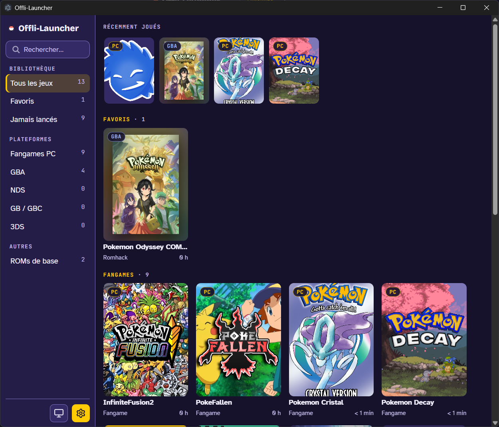
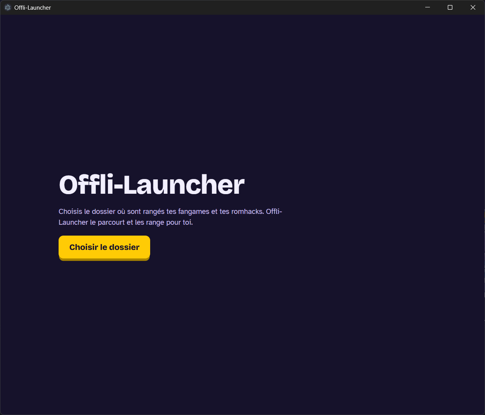

# Offli-Launcher

**Tous tes fangames et romhacks Pokémon rangés au même endroit, prêts à être lancés en un clic, même sans connexion.**

## Télécharger

Va sur la page des [versions (Releases)](https://github.com/Menthx/Offli-launcher/releases/latest) et prends le fichier qui correspond à ton ordinateur :

| Système | Fichier à prendre                                                                                                      |
| ------- | ---------------------------------------------------------------------------------------------------------------------- |
| Windows | `…-setup.exe` pour l'installer, ou `…-portable.exe` pour le lancer sans installation (depuis une clé USB, par exemple) |
| Linux   | `….AppImage` (marche partout : rends-le exécutable puis double-clique), ou `….deb` pour Debian, Ubuntu et Mint         |
| Mac     | `…-mac-arm64.dmg` pour un Mac Apple Silicon (M1, M2, M3…), `…-mac-x64.dmg` pour un Mac Intel                           |

Les fichiers `.yml` et `.blockmap` servent aux mises à jour : inutile de les télécharger.

## Premier lancement

Au premier démarrage, Offli-Launcher te demande où sont rangés tes jeux : choisis ton dossier de fangames et de romhacks. Il le parcourt et range tout pour toi. Tu pourras ajouter d'autres dossiers plus tard dans les Paramètres.

Offli-Launcher n'est pas signé numériquement (un certificat coûte cher pour un projet gratuit). Ton système va donc te prévenir la première fois. C'est normal :

**Sous Windows**, si « Windows a protégé votre ordinateur » s'affiche :

1. Clique sur **Informations complémentaires**.
2. Clique sur **Exécuter quand même**.

**Sous Mac**, si le Mac refuse d'ouvrir l'appli :

1. Fais un clic droit (ou Ctrl + clic) sur Offli-Launcher et choisis **Ouvrir**.
2. Confirme avec **Ouvrir**.

Si ça ne suffit pas : Réglages Système > Confidentialité et sécurité, puis **Ouvrir quand même**.

## Ce que ça fait

- **Trouve tes jeux tout seul** : fangames RPG Maker et Pokémon SDK, romhacks GB, GBC, GBA, DS et 3DS. Les ROMs officielles non modifiées sont rangées à part.
- **Regroupe les versions** d'un même fangame : une seule carte, et tu choisis la version dans la fiche.
- **Met des jaquettes automatiquement** : écran titre du jeu, jaquette du jeu de base pour les romhacks, ou ton image à toi.
- **Retient tes favoris et ton temps de jeu**, avec une section « Récemment joués ».
- **Big Picture** : un affichage pour jouer au clavier ou à la manette, depuis le canapé.
- **4 thèmes de couleurs** : Console, Électrique, Poké Ball et Émeraude.
- **Chemin des fichiers masqué** dans la fiche : il ne s'affiche que si tu cliques sur « Afficher » (pratique pour les captures d'écran).
- **Renomme un jeu** en cliquant sur son nom dans la fiche.

## Raccourcis

| Touche                     | Effet                                                       |
| -------------------------- | ----------------------------------------------------------- |
| Ctrl + K                   | Aller à la recherche                                        |
| Entrée (dans la recherche) | Lancer le premier jeu trouvé                                |
| Échap                      | Vider la recherche, fermer une fenêtre, quitter Big Picture |
| F11                        | Passer de la bibliothèque à Big Picture, et inversement     |

En Big Picture, à la manette : la croix ou le stick pour choisir, **A** pour jouer, **X** pour les favoris, **B** pour revenir à la bibliothèque. Au clavier : les flèches, **Entrée**, **F** et **Échap**.

## Questions fréquentes

**Faut-il configurer un émulateur ?**
Non. Si tes `.gba`, `.nds`… s'ouvrent déjà avec un émulateur quand tu double-cliques dessus (mGBA par exemple), Offli-Launcher utilise le même. Tu peux aussi en choisir un par console dans Paramètres > Émulateurs. Sous Linux et Mac, les fangames Windows se lancent avec Wine.

**Comment changer l'image d'un jeu ?**
Dans la fiche du jeu, bouton **⋯** puis **Changer l'image**. **Réinitialiser l'image** remet l'image automatique.

**C'est quoi SteamGridDB ?**
Un site communautaire de jaquettes. Avec une clé gratuite, Offli-Launcher peut y chercher des images, et tu peux choisir la tienne avec **⋯ > Choisir sur SteamGridDB…**. Pour obtenir une clé : crée un compte sur [steamgriddb.com](https://www.steamgriddb.com/), va dans ton profil > Préférences > API, puis colle la clé dans Paramètres > Images.

**Où sont stockées mes données ?**
Sur ton ordinateur uniquement (réglages, favoris, temps de jeu, images en cache) :

- Windows : `%APPDATA%\offli-launcher`
- Linux : `~/.config/offli-launcher`
- Mac : `~/Library/Application Support/offli-launcher`

Tes jeux ne sont jamais modifiés ni déplacés.

**Est-ce que quelque chose est envoyé sur Internet ?**
Non, sauf pour les jaquettes : les images des jeux de base sont téléchargées une fois (option désactivable dans Paramètres > Images), et SteamGridDB n'est contacté que si tu l'as activé avec ta clé. Rien d'autre ne sort de ton ordinateur.

---

Tu veux contribuer ? Tout est expliqué dans [docs/DEVELOPPEMENT.md](docs/DEVELOPPEMENT.md).
